# Clawith 改造实录：从智能体工作台到用户环境强制分离

记录日期：2026-11-04 · 分类：AI 应用 / 智能体工程 / 用户隔离

两个人使用同一个“项目助手”，可以获得相同的技能，但不应该因此共享私人文件、聊天记忆或后台任务。这是我这轮 Clawith 改造最终要守住的边界。

最初的需求从使用体验出发：智能体多了以后怎么找，新会话第一句话怎么问，上传和生成的文件到哪里找。随着工作台、自动提问和个人文件目录逐步落地，问题也延伸到了服务端：**每次运行到底代表谁，能使用哪些资料，结果应该交给谁？**

本文按“产品体验—架构边界—执行流程—验收与取舍”整理这轮实践。内容依据截至 2026 年 11 月 4 日的项目笔记；历史测试结果会单独标明，不将实现记录当作当前生产环境已全面验证的结论。

文中收录原笔记的 8 张截图，点击可查看大图。深色遮盖块用于隐去内部组织、地址、账号及业务信息；用户统一标为 A、B，同文件接口对照中的智能体和文件统一标为 AGENT-X、FILE-X。遮盖区文字是脱敏注释，界面布局与 200／404 等关键结果保留原貌。架构和流程图可缩放、拖动查看。

## 目录

1. [从使用体验开始](#product)
2. [共享智能体定义，分离个人运行状态](#architecture)
3. [身份、路径和存储共同约束文件访问](#files)
4. [公共资料发布与上下文来源](#context)
5. [后台任务和审批继续保留原用户身份](#tasks)
6. [代码执行使用独立禁网容器](#sandbox)
7. [把完整请求串起来](#request)
8. [验收证据与仍需补齐的检查](#validation)
9. [兼容性代价与工程收获](#tradeoffs)
10. [实现索引与迭代阶段](#implementation)

<h2 id="product">从使用体验开始</h2>

### 工作台：先找到智能体，再开始任务

原来的平铺导航在智能体数量增加后变得难找。我将分类管理、使用范围和使用者管理集中到工作台，侧边栏则采用分类与智能体分栏的方式，并衔接历史会话。

一个智能体可以属于多个分类，例如“数据分析助手”同时出现在“业务分析”和“办公工具”里。删除分类只解除归属关系，不删除智能体；没有分类的智能体回到“未分类”。分类名称在同组织内保持唯一。

分类编辑还要处理多人维护的情况：页面提交时带上读取到的旧状态，如果其他管理员已经修改成员或名称，服务端返回冲突，避免旧页面覆盖新结果。使用范围保存也核对权限状态，减少多个管理入口相互覆盖。

分类解决查找问题，访问规则决定能否使用。将智能体放进某个分类，本身不会授予权限。

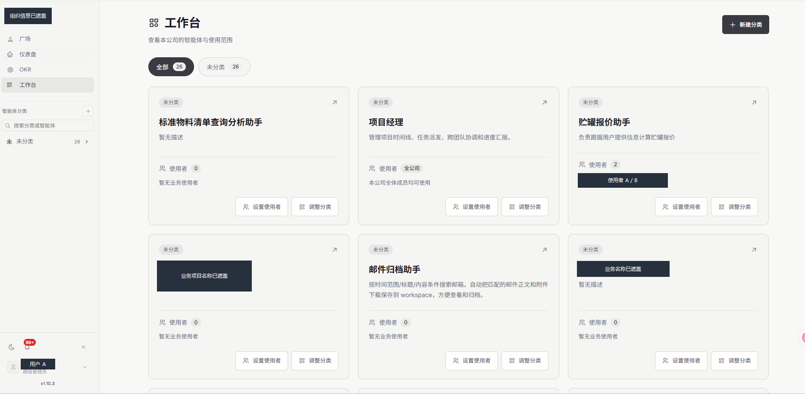

### 使用范围：能使用，不等于能管理

使用范围支持组织成员、指定使用者，以及明确授权的外部人员。全组织可用时，不再要求重复勾选全部组织成员。

普通使用者可以聊天、上传和查看自己的文件；设置、自我意识、全部文件等管理入口按管理权限显示。页面隐藏入口改善体验，服务端的权限检查负责真正阻止越权。

管理员进入自己的聊天时，个人文件工具仍然限定在管理员本人的范围。管理权限和个人运行权限分别处理，避免聊天中的模型自动获得整个智能体目录的访问能力。

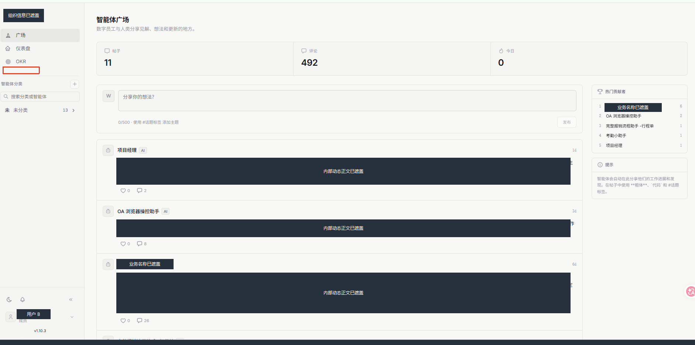

### 新会话自动提问：让第一步更明确

管理员可以配置一段提问，例如“请介绍你的能力，并说明我需要提供哪些资料”。符合条件的网页个人会话创建后，系统将其作为用户消息发起，再由模型回答。因此它是自动提问，不是写死的欢迎回复。

难点在重复执行：刷新页面、多窗口打开、断线恢复，都可能再次触发请求。为此，服务端保存创建会话时的提问快照，以及等待、运行、失败、中断、取消等状态，通过会话锁、消息编号和执行尝试编号协调领取。

同一次待执行状态不能被多个窗口重复领取。执行中记录心跳，恢复时识别中断；重试还需确认原尝试匹配、原消息存在，并且没有后续用户提问，避免旧提问在用户继续聊天后突然重新执行。

自动提问的状态变化如下。图中的“完成状态”描述正常结束，不额外假定实现中的状态字段名称。

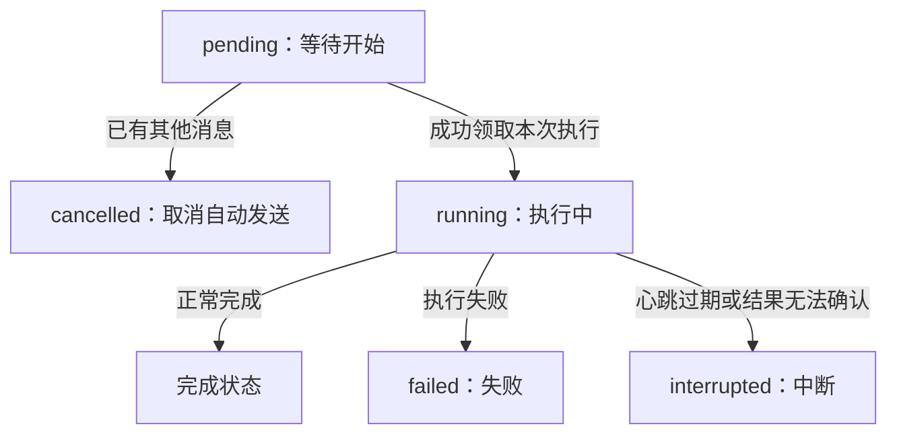

### 我的文件：区分工作过程和最终交付

“我的文件”按**当前智能体＋当前用户**汇总多个会话里的上传文件和生成文件，提供预览、下载、删除及状态提示。

文件目录保存所有者、组织、存储位置、内容版本、状态和来源记录，实际文件仍在存储系统中。上传时登记原件，最终回答中出现的有效交付引用则登记为交付文件；模型提到一个文件名，并不代表文件已经生成。

最终交付复制为个人快照，避免原工作文件被覆盖后，已交付内容跟着变化。原样返回上传原件时保留上传身份，避免重复登记。目录登记失败可以重放，不应因此再次调用模型生成回答。

删除按已登记版本处理并保留历史状态，同路径后来出现新文件也不应让旧链接重新生效。办公文件预览以内容提取为主，不承诺完整还原原生排版。中间过程文件也不自动等于最终交付。

旧文件通过“扫描候选—导出库存—核对来源—补登记”迁移，不能根据文件名猜所有者。补齐目录记录，只解决可追溯管理；能否再次交给模型使用，还需要有效的来源凭据。

<h2 id="architecture">共享智能体定义，分离个人运行状态</h2>

这次没有给每个人复制整套智能体服务，也没有重写原有前后端。前端负责展示，FastAPI 提供接口，业务服务执行权限规则，数据库保存结构化状态，存储系统保存文件。

重点是把三类数据分开：

| 数据类别 | 典型内容 | 使用规则 |
| --- | --- | --- |
| 智能体配置与草稿 | 角色设定、技能草稿、组织资料草稿 | 通过管理入口维护，不因放在共享目录就自动进入个人运行 |
| 审核后的公共发布资料 | 固定版本的角色、技能和知识资料 | 按受众授权只读使用，可以撤销 |
| 个人运行资料 | 上传、交付、记忆、历史、任务和审批 | 绑定本人，不被其他使用者继承 |

这里的“公共”是向指定使用者或组织共享，不是向互联网所有人开放。“强制分离”指服务端执行的数据与能力边界，不代表每人都有独立服务器、数据库或模型。

### 整体架构与执行边界

个人访问范围连接文件、记忆、任务和模型上下文；后台任务恢复时重新建立这一范围，再进入同一条来源检查链路。

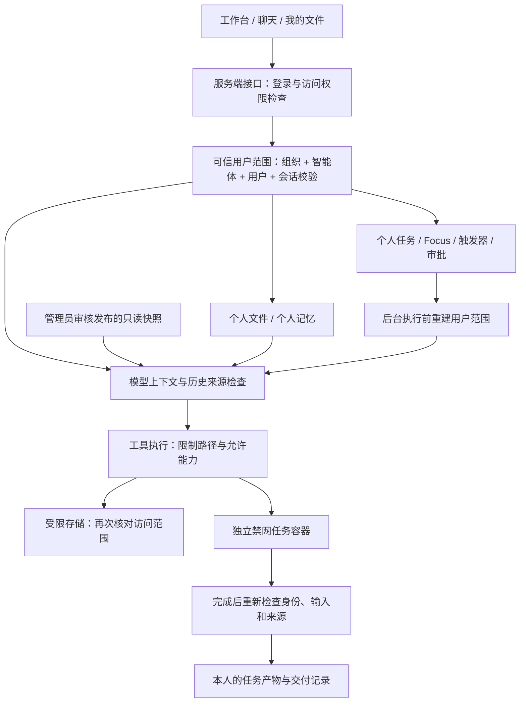

这些是职责边界，不意味着每一步都是独立部署的服务。

### 个人目录、公共快照和来源凭据

个人工作区与记忆按用户分开，公共资料保留发布快照，来源凭据由服务端单独保存：

```text
<agent_id>/
  workspace/
    <user_A_id>/
      uploads/...
      runs/<task_id>/...
    <user_B_id>/
      uploads/...
      runs/<task_id>/...
  user_memories/
    <user_A_id>.md
    <user_B_id>.md

_publications/<agent_tenant_id>/<agent_id>/<publication_id>/
  manifest.json
  ...发布快照内容...
  revoked.json                 # 撤销后出现的独立标记

_provenance/<user_tenant_id>/<agent_id>/<user_id>/
  ...服务端持有的来源凭据...
```

这是逻辑存储键示意，不是固定的服务器绝对路径。私人文件路径本身没有直接写入组织编号，因此组织隔离还依赖服务端身份校验与数据库记录，不能只看目录结构就认为全部鉴权已经完成。

<h2 id="files">身份、路径和存储共同约束文件访问</h2>

### 先确定操作者，再处理模型请求

核心对象 `UserFileScope` 可以理解为本次运行的个人访问范围。服务端根据登录状态和数据库记录，确认用户有效、有所属组织、有权使用智能体；提供会话编号时，还要验证会话确实属于这个用户和智能体。

群聊、跨智能体对话不直接套用个人会话身份。对于明确授权的外部使用者，同时保留用户所属组织与智能体所属组织，避免把“能使用智能体”误解成“能读取它所属组织的全部资料”。

身份不来自模型填写的 `user_id`，也不来自用户在对话中自称的身份。必要身份缺失时直接拒绝，不回退为智能体创建者。

### 工具只能使用本人的路径

当 A 的模型请求读取：

```text
read_file("workspace/reports/result.md")
```

服务端将访问限定到：

```text
workspace/<user_A_id>/reports/result.md
```

直接指定 B 的用户目录会被拒绝。路径检查还覆盖上级目录跳转、绝对路径、盘符、混合分隔符、控制字符、歧义编码、尾部空格和尾部点等情况。只处理明确的路径字段，不把文件正文当成身份指令。

个人记忆限定为本人的 `user_memories/<user_id>.md`。空目录搜索可以映射到本人工作区，但不能扩大成整个智能体根目录搜索。

### 存储层再检查一次

`ScopedStorageBackend` 是只暴露获准目录或文件的存储接口。即使上层工具漏掉某项判断，读、写、删除、列表和版本查询仍需经过这一层。

它不返回可以绕开检查的实时本地路径，个人下载也通过重新验证身份的应用接口完成，不直接发放对象存储临时直链。文件链接可能把目录内的名称指向目录外，因此本地保护还要检查链接、特殊文件和路径替换，不能仅靠字符串前缀判断。

这部分本地保护依赖 Linux 的目录文件描述符、禁止跟随链接等能力，能力不足时拒绝操作。不能据此承诺 Windows 原生本地存储或所有远程存储已经完成同等验证。

### 文件编号和下载地址不是访问许可

列表、预览、下载和删除同时检查组织、智能体、所有者与文件状态。即使 A 把下载地址发给 B，B 也不能因为使用同一个智能体就取得文件。

项目笔记记录的双账号观察如下，属于当时接口检查的结果：

| 操作 | 文件所有者 A | 另一个使用者 B |
| --- | --- | --- |
| 下载同一文件 | 200，成功 | 404，文件不存在 |
| 预览同一文件 | 200，成功 | 404，文件不存在 |

返回 404 可减少对文件是否存在的额外暴露。个人状态响应同时使用私有、禁止缓存等策略，降低切换账号或共享缓存造成混用的风险。

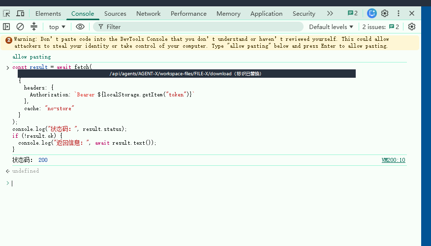

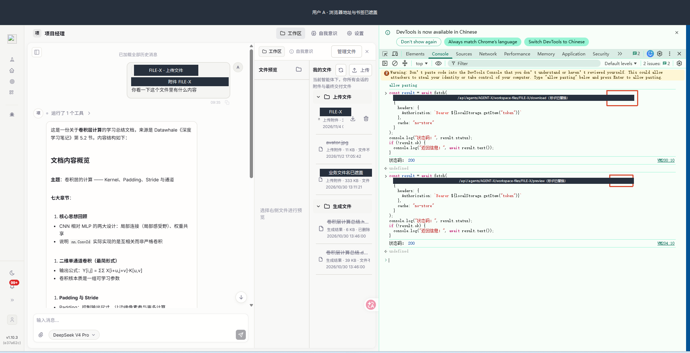

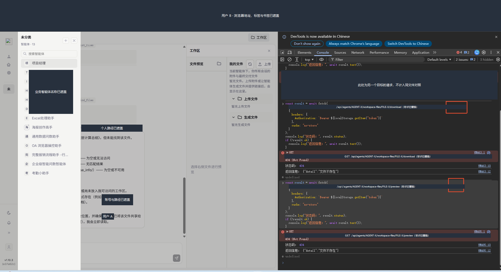

这三张截图保留的是当时的双账号观察，不能单独证明所有入口安全，也不能代替当前部署版本的重新验收。

<h2 id="context">公共资料发布与上下文来源</h2>

模型上下文，就是一次请求交给模型的材料。文件接口再严格，如果启动时已经注入其他人的记忆，边界仍然失效。因此，检查必须发生在材料进入模型之前。

### 公共资料经过明确发布

管理者先预览资料并确认内容哈希，再发布固定版本。哈希可以理解为内容指纹，用于发现审核后文件被替换的情况。

发布记录包含组织、智能体、发布人、受众、文件大小、路径、版本和内容指纹。允许的来源限制在角色文件、技能和组织资料等规定范围，私人工作区不能成为任意公共来源。

模型通过以下虚拟只读路径使用快照：

```text
public/<publication_id>/<version>/<file_path>
```

每次读取仍检查受众、版本、撤销状态和内容指纹。草稿后来修改，不会静默覆盖已经发布的版本；管理员的个人聊天工具也不能直接修改公共快照。

### 历史和衍生内容也要知道来源

仅禁止读取原文件还不够。如果之前的总结、记忆或导出文件可以无条件复用，资料撤销仍可能被绕过。

`context_provenance.py` 保存来源凭据，也就是“这段内容来自哪里、依赖哪些授权资料”的记录。凭据绑定组织、智能体、用户、内容摘要和记录键；聊天记录还绑定会话与角色，公共依赖则保存发布编号和版本。

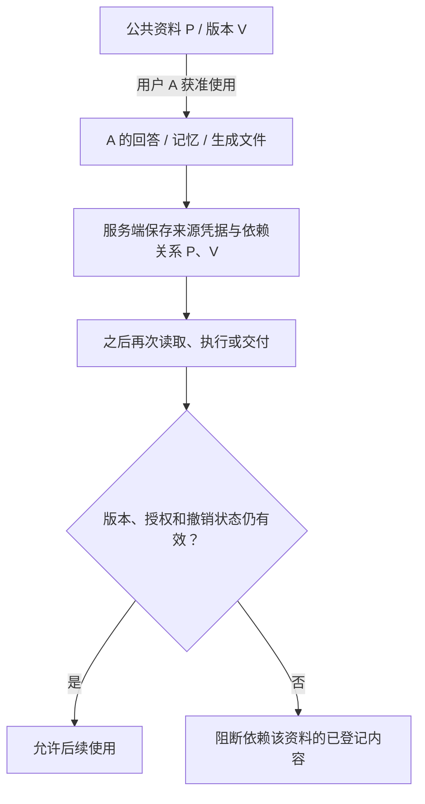

撤销公共版本后，系统阻断依赖它的已登记内容的后续使用。再次写入相同文字也不能直接清空原依赖；凭据放在用户工具不能编辑的服务端区域，模型写一句“已授权”不会获得权限。

缺少有效凭据的旧历史可以保留，但不会自动注入新请求。旧工具结果、任意摘要或模型思考内容，也不能直接包装成新的用户输入。截图等视觉材料同样需要核对用户和来源，避免共享缓存串入他人的画面。

这套机制控制系统内的后续读取、执行和交付，不会收回用户已经看到或下载的内容，也不能追踪所有人工复制、改写或线下传播。

<h2 id="tasks">后台任务和审批继续保留原用户身份</h2>

个人状态还包括 Focus 工作事项、待办和触发器。它们都加入服务端所有者信息，读取和修改时核对归属；部分内部名称带用户前缀，避免 A、B 的同名任务相互影响。客户端也不能通过提交内部字段替换所有者或路由信息。

定时执行主要支持可以确认所有者的 cron、interval 和 once，即按规则、按间隔或单次执行。系统触发器、跨智能体消息、webhook 载荷不能直接冒充个人任务输入。

后台执行通过 `deferred_execution.py` 重建用户范围，校验个人会话和已登记输入。任务标题、描述、创建者和相关配置被修改后，不能继续用旧凭据代表原任务。执行中继续检查来源，完成后还需确认结果确实来自本次验证过的执行。

审批也遵循同样规则：批准是对某个动作的业务许可，不能替代个人身份和资源权限。恢复执行仍使用原用户、原会话和原请求，检查参数是否改变、权限是否撤销，并避免同一批准重复执行。批准者的身份不能被借给申请者。

共享活动、审批摘要和日志还要减少私人提示词、回复、路径及完整错误正文，避免文件访问受到限制，内容却从日志流出。

<h2 id="sandbox">代码执行使用独立禁网容器</h2>

脚本能自行打开文件或尝试联网，所以仅限制普通文件工具还不够。专用入口 `execute_isolated_code` 为每个任务准备独立环境：

1. 确认本次用户、智能体、会话与可信运行上下文匹配。
2. 仅接受满足要求且明确标记已完成隔离验收的 Docker 配置。
3. 从本人范围准备输入快照，公共资料和个人记忆按授权只读提供。
4. 创建独立临时卷和禁网容器，不挂载宿主机完整工作区。
5. 使用非 root 用户、只读根文件系统及 CPU、内存、进程数限制，并清理凭据类环境变量。
6. 运行结束后复查输入版本、内容和授权，只收集规定目录中的普通文件。
7. 将结果写入本人的新任务目录，校验通过后再交付。

容器中的工作区是副本，脚本修改副本不等于修改真实原件。输出路径由服务端确定，脚本不能指定其他人的落盘位置；危险路径、链接和特殊文件不能直接导出。

原记录中的输入准备限制约为 100 个文件、32 MiB 总量，并另有遍历规模和代码长度限制。超时、取消和异常需要清理任务资源，避免子进程继续运行。

**默认 `isolation_verified=False`，默认配置不会自动满足执行要求。** 具备实现不等于部署后已经启用，安全环境不可用时直接失败，不降级到宿主机执行，也不偷偷换后端重试。

多文件输出也不是一个整体数据库事务。交付中途失败时可能已有部分文件落盘，需要明确报告部分保存或待核对状态，不能承诺任何失败都会自动回滚全部产物。

<h2 id="request">把完整请求串起来</h2>

以 A 上传报表并要求分析为例：服务端先确认 A 有权使用智能体，且会话属于 A；上传文件进入 A 的工作区，并登记归属和来源。模型只接收 A 获准使用的公共资料、个人记忆和可核验历史。

模型读取文件时，工具和存储共同把路径限制在 A 的范围。若需要代码分析，先检查容器是否达到验收与启用条件，否则明确失败。执行过程中权限、输入或公共资料状态发生变化时，停止后续使用或交付。

成功结果进入 A 的新任务目录，并登记最终交付。B 即使使用同一个智能体，也不能通过 A 的文件编号、历史或任务结果直接取得资料。

这里没有任何一步依靠模型自行判断“我大概应该能看”。访问边界由服务端建立，并在真正读取、执行和交付时检查。

下面的时序图把上传、模型读取和交付前复查放在同一次请求中。图中的允许或停止由实际检查结果决定，不表示所有部署环境已经完成验收。

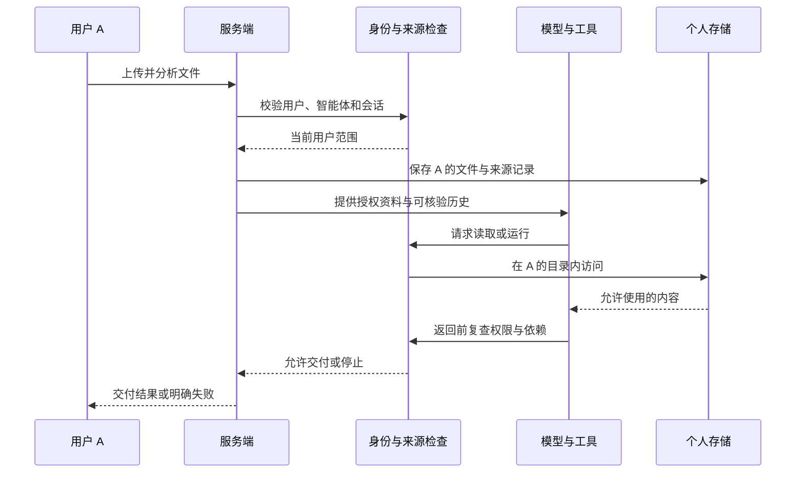

<h2 id="validation">验收证据与仍需补齐的检查</h2>

这次博客整理没有重新运行 Clawith 测试、连接线上环境或执行真实 Docker 验收。以下保留项目笔记对证据范围的区分：

| 证据 | 原记录内容 | 能说明到哪一步 |
| --- | --- | --- |
| 历史自动化测试 | 两轮累计 468 项通过、11 项跳过 | 未附本次可复核完整日志，不视为本次重跑，也不视为 468 个互不重复用例 |
| 双账号接口检查 | A 下载、预览成功，B 对同一文件收到 404 | 支持当时对应请求的观察，不代表所有入口或当前生产版本 |
| 仓库测试文件 | 覆盖分类、文件、来源、任务、审批、容器和外部入口 | 表明编写了用例，存在文件不等于测试已通过 |
| 真实部署验收 | 真实 Docker 隔离及完整后台流程尚待完成 | 不能声称生产隔离已全面验证 |

### 构建记录与环境对照

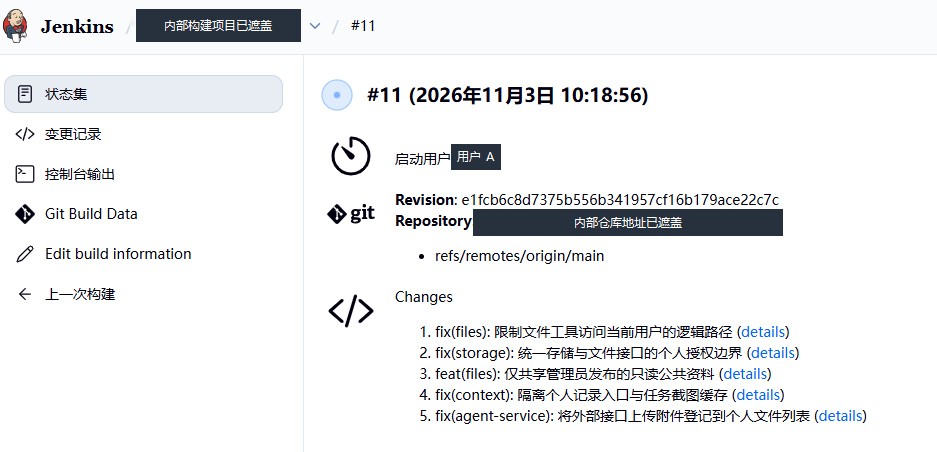

构建截图中的时间为 2026 年 11 月 3 日，只展示该次记录中的版本与变更列表，不证明后续提交已部署，也不等于完整测试或真实 Docker 验收通过。

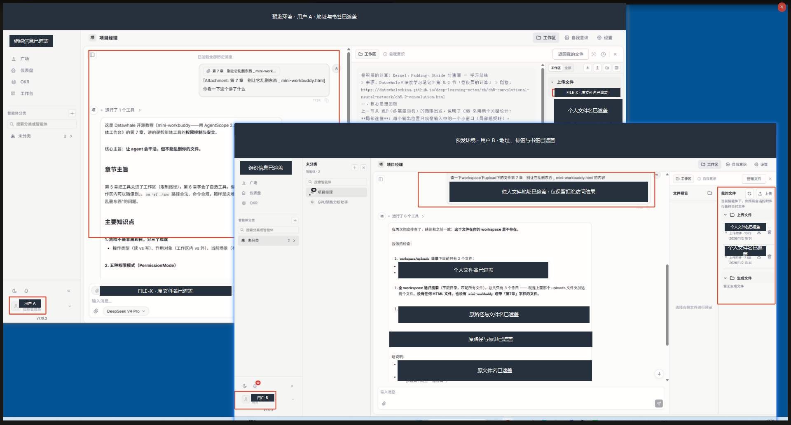

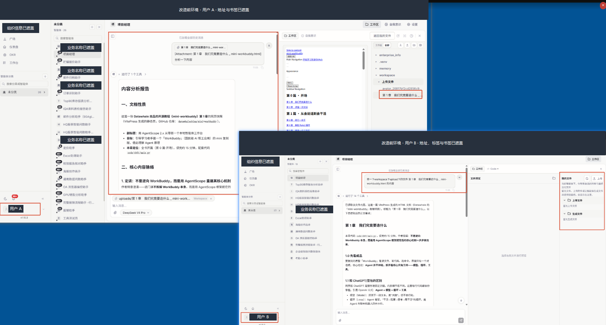

这两张环境对照图使用的资料和请求并不完全相同，也没有完整部署清单，适合说明当时观察到的现象，不能当成严格控制变量的前后回归测试。更直接的同文件访问证据见前文图 3～5；真实隔离能力仍需完整接口、工具、历史、后台任务与容器验收。

### 后续验收矩阵

下一轮验收应重点补齐：

| 场景 | 检查重点 |
| --- | --- |
| 同智能体双账号 | A 上传后，B 的枚举、搜索、预览、下载和工具读取均无法取得 A 的资料 |
| 伪造身份与路径 | 他人用户编号、会话编号、上级目录、绝对路径、编码分隔符和链接均不能扩大范围 |
| 资料撤销 | 原资料及依赖它的已登记总结、记忆、交付在后续使用时重新检查 |
| 执行中撤权 | 停用用户、撤销资料后停止后续执行或交付 |
| 后台任务与审批 | 同名任务不混用，修改参数或撤销权限后旧批准不继续生效 |
| 真实容器 | 无法访问网络、宿主目录或其他任务卷；取消和超时后清理资源 |
| 自动提问与删除 | 多窗口不重复领取执行，旧文件链接不因同路径出现新文件而复活 |

其中，默认跳过真实环境测试不能算容器隔离验收通过。

<h2 id="tradeoffs">兼容性代价与工程收获</h2>

### 无法确认归属的能力暂时停止

严格隔离版本采用默认拒绝，意味着部分原有能力暂不可用：

| 能力 | 本轮记录的处理方式 |
| --- | --- |
| 服务 API 密钥、外部即时通信入口 | 未完成个人身份和来源衔接时停止执行 |
| 跨智能体执行与发送 | 防止私人内容进入另一智能体的共享运行 |
| MCP、部分网关和远程执行 | 未接入相同来源与隔离边界时拒绝调用 |
| 普通运行中未列入许可的工具 | 拒绝执行，不在事后补授权 |
| 聊天页面发布 | 工具映射仍存在不代表已进入普通运行允许集合 |

早期提交实现过接口附件登记，但后续严格边界停止了相应服务调用，不能据此宣称外部附件链路当前端到端可用。恢复能力需要补齐身份、来源、输出归属及撤权检查。

### 上线也涉及资料和历史的整理

旧共享目录不会自动变成获准使用的公共资料，管理员需要重新预览、审核和发布。没有来源凭据的旧历史可能仍在界面中，却不再自动进入模型请求，用户可能需要重新提供材料或完成可验证迁移。

这些影响需要在上线说明中讲清楚。服务器管理员在操作系统层的权限属于另一层信任边界，也不应与应用内的个人运行隔离混为一谈。

### 最值得保留的工程经验

这轮改造让我更明确地把“提供同一种智能体能力”和“使用同一份个人数据”分开设计。工作台、自动提问和文件目录让使用路径更清楚，而服务端身份、来源记录和执行复查决定多人共用时能否保持边界。

下一步应先补齐真实容器、后台审批和部署后的双账号验收，再按同样规则逐项恢复外部能力。描述成果时，也应始终分清已实现、历史验证和仍待验收。

<h2 id="implementation">实现索引与迭代阶段</h2>

以下路径来自项目笔记，后端相对路径均位于 `backend/app/`，便于回到对应版本定位职责：

| 模块 | 关键文件 |
| --- | --- |
| 工作台与使用范围 | `api/agent_catalog.py`、`services/agent_catalog.py`、`services/agent_usage_access.py`、`core/permissions.py` |
| 自动提问 | `services/auto_start_prompt.py`、`models/chat_session.py` |
| 文件目录与交付 | `services/workspace_file_catalog.py`、`services/workspace_file_access.py`、`services/workspace_deliveries.py` |
| 用户范围与存储 | `services/user_file_scope.py`、`services/storage_runtime/scoped.py`、`services/storage_runtime/local_safety.py` |
| 公共资料与上下文 | `services/publications.py`、`services/agent_context.py`、`services/context_provenance.py` |
| 个人状态与后台执行 | `services/personal_state.py`、`services/deferred_execution.py`、`services/task_executor.py` |
| 审批与代码执行 | `services/autonomy_service.py`、`services/isolated_execution.py`、`services/sandbox/local/docker_backend.py` |

前端主要入口包括 `Layout.tsx`、`AgentCatalog.tsx`、`AgentDetailPage.tsx` 和 `UserWorkspaceFilesPanel.tsx`。

原记录将本轮 33 个提交归为以下阶段，日期均为 2026 年：

| 阶段 | 日期 | 主要结果 |
| --- | --- | --- |
| 开发整理与分类工作台 | 10-26～10-28 | 启动入口、分类管理和多分类关系 |
| 使用范围与导航 | 10-28～10-29 | 组织及指定人员授权、外部人员、分栏导航和交互修整 |
| 会话引导与个人文件 | 10-29～10-30 | 自动提问、失败恢复、上传登记、交付识别及历史核对 |
| 隔离与来源 | 11-03 | 文件授权、公共资料、上下文、撤销依赖和任务容器 |
| 个人执行加固 | 11-04 | 任务、审批与外部入口边界 |

原需求还提到技能批量及文件夹上传，但记录中没有足够证据将其计为本轮新增成果，本文不将其列入完成项。基线已有的多智能体、渠道和模型接入能力，也不归入本次新增。
