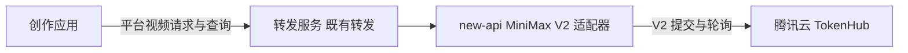
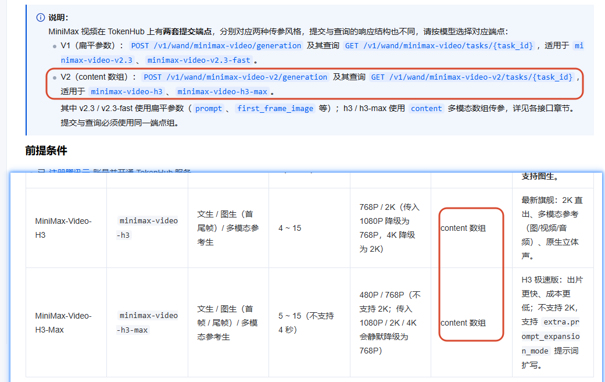
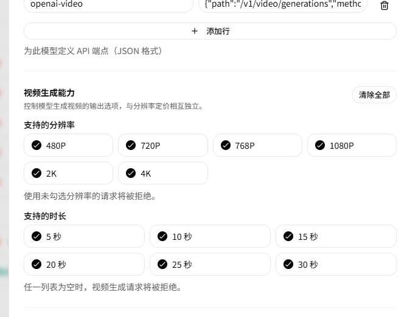
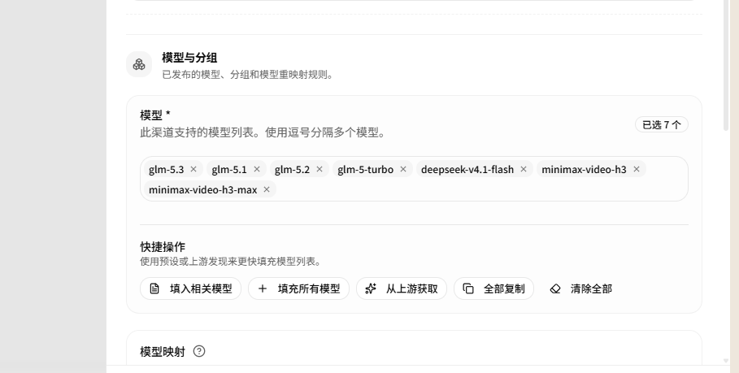
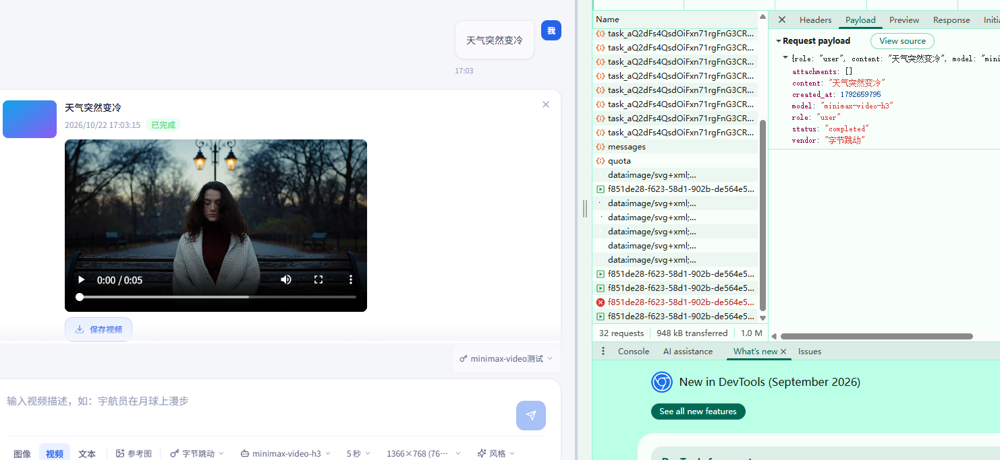

# New-api 新增腾讯云 MiniMax 视频 V2 适配器

记录日期：2026-10-22 · 分类：AI 基础设施 / 模型接入 / 视频生成

完成腾讯云 TokenHub 的 MiniMax H3 系列视频接入，在 new-api 中新增独立 V2 视频适配器，并同步创作应用的分辨率选项与显示标签。现有页面截图已确认：`minimax-video-h3` 的 5 秒、768P 文生视频请求能够提交、轮询，并展示已完成的视频。

本次只支持 `minimax-video-h3`、`minimax-video-h3-max`，V1 的 `minimax-video-v2.3`、`minimax-video-v2.3-fast` 不在此次适配范围内。

## 目录

1. [问题背景](#问题背景)
2. [三个项目的职责](#三个项目的职责)
3. [适配器的主要实现](#适配器的主要实现)
4. [后台与创作应用的最终配置](#后台与创作应用的最终配置)
5. [验证结果](#验证结果)
6. [关键代码位置](#关键代码位置)
7. [交付记录](#交付记录)
8. [现场截图](#现场截图)
9. [关联记录](#关联记录)

## 问题背景

最初在平台调用 H3、H3-Max 时，遇到以下错误：

```json
{
  "code": "fail_to_fetch_task",
  "message": "{\"Type\":2,\"Code\":1001,\"Msg\":\"Invalid param\",\"Desc\":\"\"}",
  "data": null
}
```

排查发现，腾讯云为 MiniMax 视频提供了两套协议：旧版 v2.3 系列使用 V1 的扁平参数，H3 系列使用 V2 的 `content` 数组，提交端点、查询端点和返回结构均不同。旧的通用视频转发没有处理这套 V2 差异，因此仅修改模型配置中的接口路径，不能完成接入。

还曾出现 `Invalid URL (POST /v1/wand/minimax-video-v2/generation)`：腾讯云的原生地址被填入平台对外端点后，前端请求会先进入平台自身，而平台没有直接开放这个原生路径。正确做法是保留平台统一接口，由适配器在内部转换并调用腾讯云。

错误码也应结合 HTTP 状态和完整响应判断。原始响应中的 `Code: 1001`、`Msg: Invalid param`，不能只凭数字就认定为另一张错误码表中的“缺少 Authorization”。

接口依据：[腾讯云 MiniMax 生视频调用指南](https://cloud.tencent.cn/document/product/1823/135737)。

## 三个项目的职责

| 项目 | 本次改动 | 职责 |
| --- | --- | --- |
| new-api | 新增 Tencent MiniMax V2 视频适配器，补齐模型能力和分辨率定价选项 | 参数转换、上游提交与查询、任务管理、计费和错误处理 |
| 创作应用 | 新增 768P、2K 选项，并统一显示标签 | 用户选择模型、规格，提交任务并展示生成结果 |
| 转发服务 | 无代码改动，沿用既有转发与资产处理流程 | 转发平台视频请求和查询结果 |

new-api 的“游乐场”和独立的“创作应用”是两个不同入口。本笔记中的实际生成截图来自“创作应用 → 视频”。



## 适配器的主要实现

### 1. 按渠道和映射后的模型选择 V2 协议

在 OpenAI 类型渠道、腾讯云官方 Base URL 下，模型经过渠道映射后为下列名称时，切换到独立适配器：

- `minimax-video-h3`
- `minimax-video-h3-max`

这样可以支持平台模型别名，同时避免将其他上游的同名模型误送到腾讯云 V2 协议。同一腾讯云渠道中的其他模型继续使用原有处理流程。

### 2. 保留统一视频接口，内部转换上游协议

| 用途 | 平台公开接口 | 腾讯云上游接口 |
| --- | --- | --- |
| 提交 | `POST /v1/video/generations` 或 `POST /v1/videos` | `POST /v1/wand/minimax-video-v2/generation` |
| 查询 | `GET /v1/video/generations/{公开任务ID}` 或 `GET /v1/videos/{公开任务ID}` | `GET /v1/wand/minimax-video-v2/tasks/{上游任务ID}` |

适配器使用渠道 Key 构造 `Authorization: Bearer ...`，并发送 JSON 请求。平台的公开任务 ID 与腾讯云真实任务 ID 分开保存，查询时使用内部保存的上游 ID。

提交时将任务绑定到内部平台标记 `tencent-minimax-v2`，后台轮询据此选择相同适配器，确保提交和查询始终使用同一套 V2 协议。复用已有任务存储结构，无需新增数据库表或字段。

### 3. 转换文字、首尾帧和参考素材

- 将平台已有的 `prompt`、图片、视频字段转换为腾讯云要求的 `content` 数组，也接受原生 `content` 输入。
- 支持文字、首帧/尾帧图片，以及图片、视频、音频参考。高级组合通过接口中的 `content` 数组使用，创作应用沿用现有素材入口。
- 校验素材角色、数量及 URL/Base64 格式；首尾帧与参考模式互斥，音频参考需要搭配参考图片或视频。
- `metadata` 可提供默认参数，顶层字段优先；显式传入的 `aigc_watermark: false` 会保留。
- H3-Max 支持 `extra.prompt_expansion_mode`；此次 V2 适配采用 JSON 素材地址/Base64 输入，不支持直接上传二进制文件或 remix。

### 4. 在预扣费前处理实际生效的规格

| 模型 | 原生分辨率 | 兼容输入的处理 | 上游时长规则 |
| --- | --- | --- | --- |
| minimax-video-h3 | 768P、2K | 1080P → 768P；4K → 2K | 整数 4～15 秒，超出范围回落为 5 秒 |
| minimax-video-h3-max | 480P、768P | 1080P、2K、4K → 768P | 整数 5～15 秒，超出范围回落为 5 秒 |

缺少必填时长、非整数时长，以及互相冲突的 `duration`/`seconds` 会被拒绝；720P 不会自动当作 768P。

请求值与生效值分别留存。预扣费使用生效后的时长和分辨率，避免请求 20 秒、实际按 5 秒生成，却仍按 20 秒预扣。消费日志中增加 `video_parameters`，记录 `requested_duration`、`effective_duration`、`requested_resolution`、`effective_resolution`，便于排查规格变化。

### 5. 接入既有异步结算与错误处理

将 `task.usage.output_seconds` 转换为统一的 `usage.duration`、`output_video_duration`，保留输入秒数、其他原始用量和 `tokenhub_usage.total_tokens`。已配置按秒计费、且保存了计费快照的任务，成功后沿用现有差额结算流程。

实际用量以输出秒数为依据；没有有效输出用量时，不用请求时长或 `task.duration` 冒充实际用量。

生成请求发出后禁止自动重提，避免网络异常时自动换 Key 或换渠道再次创建视频。查询请求失败不直接等同于生成任务失败；`failed`、`cancelled`、`expired` 等终态接入现有失败与退款流程，错误中保留 `request_id`，方便向上游追查。

## 后台与创作应用的最终配置

### 渠道配置

在 new-api 中使用现有“腾讯云-原厂直供”渠道：

- 渠道类型：OpenAI。
- Base URL：`https://tokenhub.tencentmaas.com`。
- 添加本次支持的两个 H3 系列模型，并配置有效的腾讯云渠道 Key。

### 模型端点

在两个模型的端点配置中保留平台路径：

```json
{
  "video": {
    "path": "/v1/video/generations",
    "method": "POST"
  },
  "openai-video": {
    "path": "/v1/videos",
    "method": "POST"
  }
}
```

### 视频能力与时长选项

建议分别配置 H3 的 768P、2K，以及 H3-Max 的 480P、768P；本次页面验证先使用 5 秒。两种模型在当前页面中可选择其已配置的 5、10、15 秒。

最终保留原来的通用秒数选项：

| 位置 | 最终选项 |
| --- | --- |
| new-api 模型能力配置 | 5、10、15、20、25、30 秒 |
| 创作应用 | 5、10、15、20 秒 |

上游合法时长范围、后台可配置选项、前端显示选项是三个层次。接口仍会核对模型能力配置，不能因为上游允许 4～15 秒，就认定当前页面可以逐秒选择。20、25、30 秒是保留给通用模型配置的原有选项，不是 H3 系列的原生生成时长。

### 分辨率标签与定价

new-api 模型能力和分辨率价格编辑支持新增的 768P、2K 档位；创作应用按后台返回的模型能力筛选选项，并统一显示为：

- `1366×768 (768P)`
- `2560×1440 (2K)`

这两个像素尺寸沿用平台的统一映射，接口实际传值仍为 `768P`、`2K`。标签不作为腾讯云实际输出像素尺寸的保证，实际文件规格还应结合模型和画幅核验。

## 验证结果

### 本地验证

以下结果来自原始开发记录，本次文章整理未重新运行适配器所在项目的检查。

- MiniMax V2 适配器测试通过，覆盖参数转换、素材角色与数量限制、规格降级、时长回落、状态解析、查询错误和公开任务 ID。
- 协议选择与模型映射测试通过，确认仅目标渠道、目标模型切换到 V2。
- 本地模拟上游的轮询、两种公开查询格式及按秒差额结算验证通过。
- 相关 Go 测试、new-api 后端构建、new-api 默认前端类型/格式/代码检查与生产构建通过。
- 创作应用类型检查及现有测试通过；恢复秒数、补齐标签后再次完成类型检查。

扩大检查时，service、controller 中出现 12 个既有测试失败项；与改动前代码对照后失败项一致。relay/common 另有既有测试初始化问题。因此本次结论是相关检查通过，不将整个仓库描述为“全量测试通过”。

### 实际页面验收

现有截图能够确认的一次请求为：

| 项目 | 记录 |
| --- | --- |
| 测试入口 | 创作应用 → 视频 |
| 模型 | minimax-video-h3 |
| 提示词 | 天气突然变冷 |
| 请求时长 | 5 秒 |
| 请求分辨率 | 768P |
| 页面结果 | 从“生成中 50%”进入“已完成”，出现 5 秒视频播放器与保存入口 |

该记录验证了 H3 文生视频的页面提交、异步查询与结果展示。H3-Max、图生视频、多模态参考、失败退款及真实费用核对仍应按各自场景补充实测记录，不能由这一张成功截图推断为全部通过。

## 关键代码位置

| 位置 | 用途 |
| --- | --- |
| V2 请求转换与校验：`relay/channel/task/tokenhub/request.go` | 原生请求构造、素材校验、生效规格处理 |
| V2 视频适配器：`relay/channel/task/tokenhub/adaptor.go` | 上游提交、查询、状态与用量转换 |
| 任务协议选择：`relay/relay_task.go` | 按渠道与映射模型选择适配器，统一公开查询 |
| 模型能力配置：`model/model_meta.go` | 分辨率和时长选项校验 |
| 任务消费日志：`service/task_billing.go` | 保存请求规格和生效规格 |
| 创作应用视频选项：`src/app/dashboard/playground/page.tsx` | 分辨率标签、秒数选项及提交流程 |

## 交付记录

以下为原笔记记录的开发交付，整理文章时未重新执行这些测试或核验分支状态：

| 项目 | 提交 | 内容 |
| --- | --- | --- |
| new-api | `76d27b6c1` | 支持腾讯云 MiniMax H3 系列 V2 视频适配 |
| 创作应用 | `54edd5e` | 补齐创作应用的视频分辨率和时长选项 |
| new-api | `5c72e66d0` | 恢复原有视频时长选项，保留 V2 适配 |
| 创作应用 | `86e2f86` | 恢复原有时长选项，并统一 768P、2K 显示标签 |

最终交付以恢复原有秒数选项后的版本为准。

## 现场截图

### 1. 腾讯云 V1/V2 协议及 H3 系列规格



### 2. new-api 模型能力配置界面

截图保留了当时的全选操作；实际模型建议按前文分别配置对应分辨率和 5、10、15 秒。端点路径以本文“模型端点”中的配置为准。



### 3. 在现有渠道中添加两个 H3 系列模型



### 4. H3 视频生成完成

页面显示“已完成”，出现时长 5 秒的视频播放器和保存入口。



## 关联记录

- [New-api 视频生成秒数不为整数的扣费问题](./new-api-video-duration-reconciliation.html)
- [视频模型积分与异步计费链路治理](./video-model-async-billing-fixes.html)
