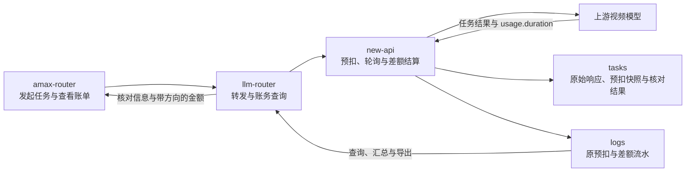
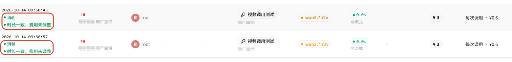
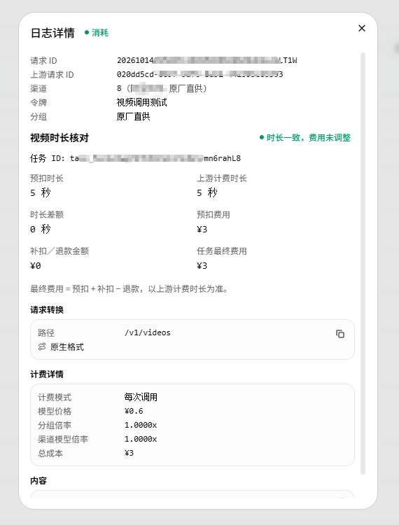
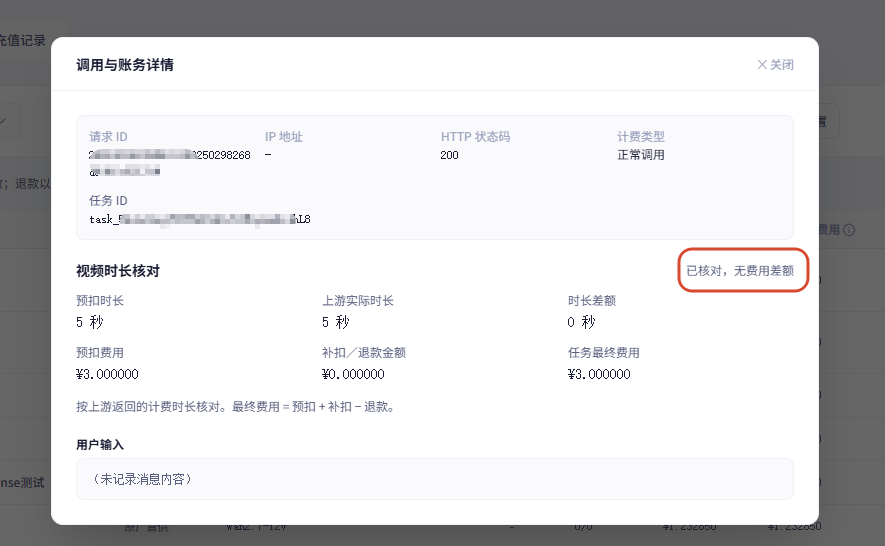
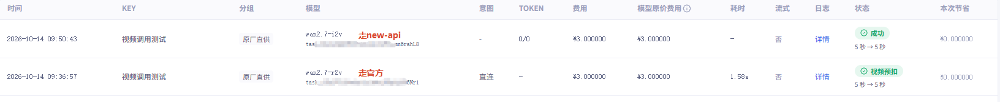

# New-api 视频生成秒数不为整数的扣费问题

记录日期：2026-10-14 · 分类：AMAX / AI 基础设施 / 视频异步计费

一次视频任务按 15 秒预扣，完成后上游报告的计费时长却可能是 15.3 秒或 14.7 秒。继续按 15 秒收费，平台会少收一部分成本，或者让用户多付费用。这次改造通过“提交时保存预扣快照，成功后按上游用量核对差额”，打通 new-api、llm-router 和 amax-router 的结算、账务查询与页面展示。

本文整理本次需求、技术设计、实际开发与排障记录。小数秒补扣、退款已经通过隔离测试；本文保存的实际页面截图验证的是 5 秒 → 5 秒的无差额分支。新旧实例混跑的快照保护、独立结算表和故障自动补账仍属于后续工作。

## 目录

1. [问题背景与计费依据](#问题背景与计费依据)
2. [业务规则与改造范围](#业务规则与改造范围)
3. [三个项目的职责与架构](#三个项目的职责与架构)
4. [小数秒费用与成本计算](#小数秒费用与成本计算)
5. [预扣快照与成功结算流程](#预扣快照与成功结算流程)
6. [两条账务流水与一次调用](#两条账务流水与一次调用)
7. [页面展示与实际截图](#页面展示与实际截图)
8. [验证结果与验收方法](#验证结果与验收方法)
9. [共享数据库与故障边界](#共享数据库与故障边界)
10. [构建排障与交付记录](#构建排障与交付记录)
11. [这次改造沉淀的经验](#这次改造沉淀的经验)
12. [参考记录](#参考记录)

## 问题背景与计费依据

视频生成是异步任务。提交成功时，视频通常还没有生成完，平台先按照当时生效的规格预扣额度；任务完成后，才能拿到上游报告的用量。

最初要解决两个问题：让下游查询接口获得原始计费用量，并让最终收费与该用量一致。请求里写了 15 秒，不代表上游最终一定按整数 15 秒计费。若实际用量是 15.3 秒，原有收费会少算 0.3 秒；若实际用量是 14.7 秒，则需要退回多预扣的 0.3 秒费用。

这里必须区分三种时长：

| 时长 | 含义 | 在本次方案中的作用 |
| --- | --- | --- |
| 请求中的时长 | 客户端希望生成的长度，提交阶段可能被规范化或调整 | 不能直接代替最终预扣事实 |
| 实际预扣计费时长 | 提交阶段已经用于扣费的时长 | 保存到快照，作为比较基准 |
| 上游 `usage.duration` | 任务完成后上游报告的计费用量 | 有效时用于最终核对 |

下载视频后用播放器或工具测得的播放时长，不是这次方案的结算依据。例如，视频文件播放 15.3 秒，但上游 `usage.duration` 返回 15，本功能仍按 15 秒核对，不自行增加收费。

两种查询接口继续透传上游用量：

| 查询接口 | 上游用量位置 |
| --- | --- |
| `GET /v1/videos/{task_id}` | `usage.duration` |
| `GET /v1/video/generations/{task_id}` | `data.usage.duration` |

上游返回 15 就保存 15，返回 15.3 就保存 15.3。预扣秒数、差额秒数与最终费用放在内部核对记录中，不改写原始 `usage`。

## 业务规则与改造范围

本次范围覆盖新提交的、按秒计费的视频任务，包括直连供应商以及经过兼容网关的链路；判断依据是计费模式与快照版本，不依赖模型名称里是否包含 Wan。

- 实际计费时长增加时补扣，减少时退款。
- 价格、折扣、倍率与资金来源沿用任务提交时的事实，完成时不读取新价格重算。
- 时长相同且没有费用、成本差额时，只保存核对结果，不新增调整流水。
- 缺失、null、空值、非法字符串、非有限值以及小于等于 0 的时长，保留预扣金额并记录未结算原因。
- 钱包补扣允许负余额；订阅和团队密钥沿用原资金来源，不自动改扣个人钱包。
- 保留原预扣流水，补扣或退款另外记录，关联同一任务与原请求。
- 费用合计按“预扣＋补扣－退款”，差额记录不增加调用次数。
- 没有新版本快照的旧任务不追溯；真正的按次、Token 和表达式计费继续走原路径。
- 成功任务缺少可计费时长，不应被改成生成失败；原失败任务退款继续使用已有流程。

普通任务查询仍是读取操作，资金调整发生在后台成功结算入口，不能因用户重复打开详情或查询任务而再次扣费。

## 三个项目的职责与架构

这次差额调整涉及三个项目，但收费规则集中在 new-api。查询服务和页面消费已经保存的账务结果。

| 项目 | 职责 | 本次改造 |
| --- | --- | --- |
| new-api | 提交、轮询、用量透传、资金调整与账务落库 | 冻结快照、计算差额、保存核对结果，补齐后台展示字段 |
| llm-router | 账务查询、汇总、筛选与 CSV 导出 | 识别调整流水，统一金额方向与调用次数口径 |
| amax-router | 用户日志与统计界面 | 展示预扣、补扣、退款、核对状态及费用详情 |



本期复用已有数据结构：

- `tasks.data` 保存原始任务响应和上游用量。
- `tasks.private_data.billing_context.duration_billing` 保存新任务的预扣快照。
- `tasks.private_data.duration_settlement_result` 保存结算状态、时长、费用差额与原因。
- `tasks.quota` 回写最终用户费用。
- `logs.other.duration_settlement` 保存用于账务展示的核对信息。
- `llm_request_logs` 继续保存请求与响应事实，不为每条差额另造一次上游调用。

new-api 没有为本期功能新增数据库表或列。查询层使用已有账务行和关联信息；展示层显示字段，不在浏览器中执行扣款。

## 小数秒费用与成本计算

### 用户费用

设 `D0` 为实际预扣计费时长，`D1` 为有效上游时长，`Q0` 为已经预扣的整数额度：

```text
D1 = D0 时：Q1 = Q0
否则：Q1 = truncate_toward_zero(Q0 × D1 ÷ D0)
额度差额 = Q1 - Q0
```

`truncate_toward_zero` 表示最终向零截断为整数额度。时长和比例使用十进制计算，保留 15.3 这样的值，最后才转换为系统的整数额度。

采用“原已收费额度 × 时长比例”，能够保留提交时已经生效的价格、折扣、倍率及原有取整结果。任务完成期间即使管理员改价，也不会把同一个任务切换到新价格。这一方法不回头修正原预扣阶段已有的额度截断误差。

差额大于 0 补扣，小于 0 退款，等于 0 不进行用户资金调整。免费任务 `Q0 = 0` 保持免费；合法的最终额度为 0 时，也需要支持退回原预扣费用。

以下为隔离测试样例：固定测试汇率为 1，500000 额度对应 1 元；预扣 15 秒、6750000 额度，即 13.50 元。

| 上游时长 | 最终额度 | 差额额度 | 调整金额 | 最终净额 |
| --- | --- | --- | --- | --- |
| 15.3 秒 | 6885000 | +135000 | 补扣 0.27 元 | 13.77 元 |
| 14.7 秒 | 6615000 | -135000 | 退款 0.27 元 | 13.23 元 |
| 15 秒 | 6750000 | 0 | 不调整 | 13.50 元 |
| 无效时长 | 保留 6750000 | 不执行差额 | 保存未结算原因 | 保留 13.50 元 |

这些金额用于验证计算方向，不是所有模型的真实价格。

### 平台成本

用户实付费用和平台上游成本分别核对。设原平台成本快照为 `C0`：

```text
C1 = round_to_6_places(C0 × D1 ÷ D0)
成本差额 = C1 - C0
```

成本按六位小数处理。原预扣成本保留，新调整流水只写成本差额，避免把最终整笔成本再次累加。

如果用户额度差额为 0，但平台成本仍有差额，可以保存金额为 0 的“成本核对”记录；页面应说明用户费用未调整。用户费用与平台成本都没有差额时，只保存核对结果。

## 预扣快照与成功结算流程

### 在正确的时刻保存快照

快照应在提交成功、提交阶段的费用调整已经完成后生成。时长取真正生效的 `OtherRatios["seconds"]`，额度取提交阶段最终的 `result.Quota`，而不是最早的请求参数。

简化后的内部结构如下：

```json
{
  "billing_context": {
    "duration_billing": {
      "version": 1,
      "billing_mode": "per-second",
      "pre_billed_duration": "15",
      "pre_billed_quota": 6750000,
      "pre_billed_cost_rmb": "13.500000",
      "quota_per_unit": "500000",
      "exchange_rate": "1"
    }
  }
}
```

内部小数以字符串保存，便于十进制精确计算。原请求、任务 ID、所属用户、密钥、团队和预扣日志 ID 等审计信息也在提交时保留，供后续关联使用。

### 在已有的成功结算入口执行

1. 轮询获取上游状态和用量，保存原始响应。
2. 用已有条件状态更新取得任务首次成功终态的处理权。
3. 检查按秒模式、快照版本及完整性。
4. 计算前后时长、额度和成本差额，生成可独立测试的结果。
5. 差额非零时调整原资金来源、密钥及对应额度统计。
6. 保存最终任务额度、核对结果，补充原预扣日志的核对信息。
7. 如有差额，写入调整流水；同值且无差额只保存核对结果。

新按秒分支放在原按次早退之前，因为现有 `PerCallBilling` 标记也可能包含按秒的视频任务。不能为了加入本功能，把整个原按次判断删除。

用量读取兼容 `usage`、`data.usage` 和 `data.data.usage` 的有限层级响应。无效用量不能误走 Token 重算，也不能阻止一个已经成功的视频继续查询和获取。

## 两条账务流水与一次调用

发生补扣或退款时，使用日志通常有两条账务记录，任务列表仍只有同一个生成任务：

| 记录 | 保存的事实 | 对调用次数的贡献 |
| --- | --- | --- |
| 原预扣流水 | 原预扣时长、费用、成本和创建时间 | 保持原调用事实 |
| 差额流水 | 本次补扣、退款或零额度成本核对 | 0 |
| 任务记录 | 一个任务的生成状态与最终核对结果 | 仍是同一次生成 |

调整行使用结构化字段，例如：

```json
{
  "billing_type": "video_duration_adjustment",
  "billing_phase": "adjustment",
  "billing_direction": -1,
  "request_count_delta": 0,
  "task_id": "task_example"
}
```

`billing_direction = -1` 表示该退款方向；`request_count_delta = 0` 表示账务调整不新增生成调用。底层退款 `quota` 保存差额绝对值，查询与展示按方向输出负金额。

列表行数和调用次数不能都用 `COUNT(*)` 表示。也不能按请求 ID 把两条流水直接去重金额，否则会漏掉差额：

```text
最终用户费用 = 原预扣费用 + 补扣费用 - 退款费用
```

跨天统计按照每条流水实际发生的时间归属。例如昨天预扣 13.50 元、今天退款 0.27 元：昨天显示预扣，今天显示 -0.27 元且新增调用为 0；范围覆盖两天时，净额为 13.23 元，仍是一次调用。

差额记录即使没有对应的历史请求详情行，也应能按所属密钥和权限展示。未开启提示词记录，不应导致账务详情不可查看。

## 页面展示与实际截图

new-api 的 default 与 classic 两套后台，以及 amax-router 的用户界面，均展示保存下来的核对结果。

状态包括已补扣、已退款、时长一致且费用未调整、待结算、未结算，以及暂无核对记录。生成成功和结算状态分别显示：没有保存核对结果时，不能仅凭“成功”推断费用已经核对。

详情展示预扣时长、上游计费时长、时长差额、预扣费用、补扣／退款金额、任务最终费用、任务 ID 和异常原因。未知字段显示 `-`，不把缺少数据伪造为 0。

以下截图保留自本次原笔记，请求与任务标识已遮挡。截图验证的是 **5 秒 → 5 秒、预扣 3 元、差额 0、最终费用 3 元**；它们不作为真实小数秒补扣／退款已经验收的证据。

### new-api 使用日志



使用日志在原消费记录旁补充“时长一致，费用未调整”标记。同值且无费用、成本差额时，不新增补扣或退款流水。

### new-api 核对详情



详情同时展示 5 秒预扣、5 秒上游计费时长、0 秒差额及最终 3 元。原预扣金额保留，最终费用单独展示。

### amax-router 账务详情



客户端读取后端核对结果，显示“已核对，无费用差额”。即使没有记录提示词内容，用户仍可查看账务信息。

### 经过网关与直接调用的对照



截图保留了经过 new-api 与直接调用的页面对照，两条任务都显示 5 秒 → 5 秒。它能说明当前样例的展示情况，不能仅凭两行数据推断所有渠道的小数秒计费都已完成真实联调。

## 验证结果与验收方法

### 已记录的验证

| 层级 | 已验证内容 | 边界 |
| --- | --- | --- |
| new-api 后端 | 十进制费用计算、钱包／订阅／团队、负余额、日志净额、旧任务、改价、无效用量、终态竞争及模拟上游透传 | 隔离内存 SQLite 和本地模拟上游，不等同于真实供应商验收 |
| llm-router | 9 项真实 PostgreSQL SQL／HTTP 测试；相关回归合计 24 项通过 | 独立临时数据库；原全套测试存在既有断言问题，未宣称全套通过 |
| amax-router | 84 项测试、类型检查、相关代码检查、生产构建和模拟页面验证 | 页面验证使用模拟接口，真实小数秒与余额联调仍需单独验收 |
| new-api 两套后台 | 各自 9 项逻辑测试，共 18 项；default 类型检查、相关代码检查与两个生产构建通过 | 两套主题独立维护本地实现；本地构建通过不能代替 Jenkins 整个镜像流水线结果 |
| 本次实际页面 | 5 秒 → 5 秒的状态标记、核对详情与客户端展示 | 没有据此宣称 15.3 秒、14.7 秒真实上游场景已验收 |

### 后续真实验收看什么

选择隔离的测试账号和新任务，分别验证时长增加、减少、相同和无效四种情况：

1. 提交后确认预扣快照的版本、时长、额度与原账务一致。
2. 完成后核对原始 `usage.duration`、保存的结算结果与最终 `tasks.quota`。
3. 费用有差额时，应看到原预扣＋调整两行；关联任务与请求一致。
4. 钱包、密钥、渠道及原资金来源的变化，应与差额一致。
5. 列表、汇总、筛选和 CSV 使用一致的正负方向，调用次数不翻倍。
6. 重复查询与正常重复轮询，不应再产生第二次资金调整。
7. 无效时长保留原金额和原因；生成成功的视频仍可获取。

自动测试样例存在于独立临时库，不能拿测试输出里的任务 ID 去线上查询。真实供应商通常返回整数时，可以先用模拟响应验证小数规则，再单独补真实链路验收。

## 共享数据库与故障边界

### 快照被覆盖，是另一类数据一致性问题

联调时实际发现：任务提交后存在新计费快照，后续进度更新后快照却丢失。本地开发与其他实例使用同一任务数据库，新旧版本共同写入是需要排查的风险。

这会使已成功任务缺少结算依据。界面应显示“暂无核对记录”，不能把未知结果显示成“时长一致”，也不能从上游秒数反向伪造原计费快照。

已记录的排查确认过快照丢失，但不能仅凭数据库连接来源认定具体哪个实例覆盖了哪一条任务。缺少快照的任务，也不能直接据当前价格自动重新扣费。

新旧版本混跑保护、独立结算存储及后台故障补处理方案已经讨论，**尚未在本期实现**。后续设计应单独考虑字段更新范围、结算唯一性、资金操作幂等与故障恢复，不能把它们写成本次已交付成果。

### 正常防重复不等于完整故障恢复

本期依靠原有条件终态更新和保存的核对结果，防止正常重复轮询、查询或竞争处理时多次结算。

资金来源、密钥额度、渠道统计、任务结果、主数据库与日志数据库之间，并没有新增一笔覆盖全部步骤的事务。若发生资金调整后写日志失败或进程中断，本期沿用原有错误处理，不新增持久重试队列、自动补账或欠款追扣系统。

因此，需要分别验证“正常重复处理不会重扣”和“故障中断后能否恢复”。前者已有本期测试，后者仍是后续工作。

## 构建排障与交付记录

本次发布还遇到了两个不同阶段的问题：

- **基础镜像拉取：** Docker 读取镜像附加元数据时报 `failed to decode referrers index`，返回内容以 `<` 开头。指定的镜像代理另一次返回 HTTP 502。核对官方清单后，按服务器对应的 `linux/amd64` 平台摘要拉取并补上原标签，成功绕过当时的附加信息查询错误。
- **前端打包：** 新增 `web/shared` 后，Dockerfile 只复制 default 和 classic 的代码，导致容器缺少共享文件。最终按两个主题各自构建的边界拆开实现：default 的逻辑放进 `src/features/usage-logs/lib/`，classic 放进 `src/helpers/`，各自保留测试，清除全部跨主题引用。

服务器当时的可用内存和磁盘空间充足；清理镜像释放的是磁盘空间，无法补齐缺失的源码。排障应先看失败阶段和第一条具体错误，再选择检查方式。

| 仓库与阶段 | 提交 | 已完成内容 |
| --- | --- | --- |
| new-api 后端结算 | `23832dfce` | 新按秒任务快照、上游时长差额结算与账务保存 |
| llm-router 查询 | `18508bb` | 差额明细、方向、汇总、筛选与导出 |
| amax-router 展示 | `7947733` | 预扣、补扣／退款与核对详情 |
| new-api 后台展示 | `b520880a4` | 两套后台结算标记与费用详情 |
| new-api 构建修复 | `b47711703` | 移除跨主题共享目录，两个主题分别维护实现 |

这些提交已经按阶段推送。本地测试、用户页面观察与整条部署流水线是不同的验证层级，应分别记录结果。

## 这次改造沉淀的经验

小数秒问题把异步计费中的几个事实拉到了一起：提交时已经收了多少、上游最终报告了多少、差额实际如何入账，以及用户如何核对。

我在这次改造中采用的几个判断标准：

- 先固定计费依据，明确比较的是已预扣时长与上游计费用量。
- 把计算与资金操作分开，先用隔离样例验证 15.3、14.7 和精度边界。
- 保留原账务事实，用追加差额流水解释最终净额。
- 区分流水行数与调用次数，让查询、统计、导出和页面使用同一方向。
- 为未知结果保留明确状态，避免“生成成功”掩盖“尚无核对依据”。
- 按各主题实际构建范围组织代码，并验证打包路径。
- 对正常防重复、混跑写入和故障恢复分别描述，不把未实现的方案当作完成状态。

这次已完成的是一条可核对的视频按秒结算路径。剩余的数据保护与故障恢复问题，需要在后续独立方案和验收中继续解决。

## 参考记录

- 本次内部需求：`new-api/docs/2026-10-13-video-duration-settlement-requirements.md`。
- 本次内部技术设计与分段验收：`new-api/docs/2026-10-13-video-duration-settlement-technical-design.md`。
- 核心实现：`service/video_duration_billing.go`、`model/task.go`、`model/log.go`，以及 llm-router 的 `utils/db_logger.py`。
- [把异步计费变成可核对账单：预扣款与退款记录全链路改造](https://dandan1232.github.io/notes/token-router-precharge-refund-ledger.html)。
- [从“金额看不懂”到可核对：视频模型积分与异步计费链路治理](https://dandan1232.github.io/notes/video-model-async-billing-fixes.html)。
